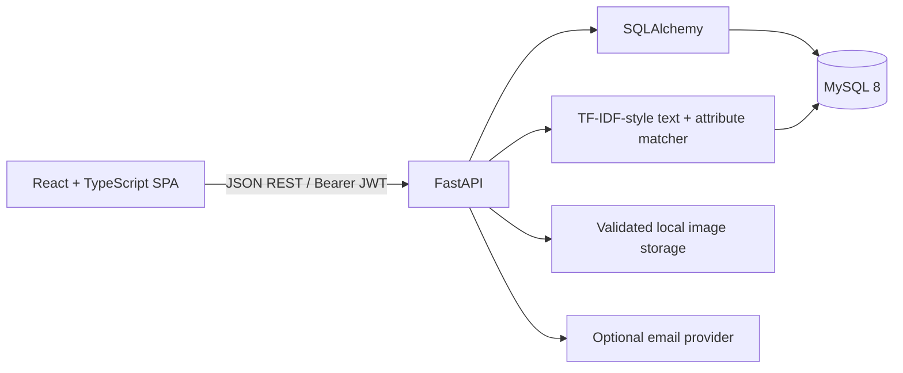
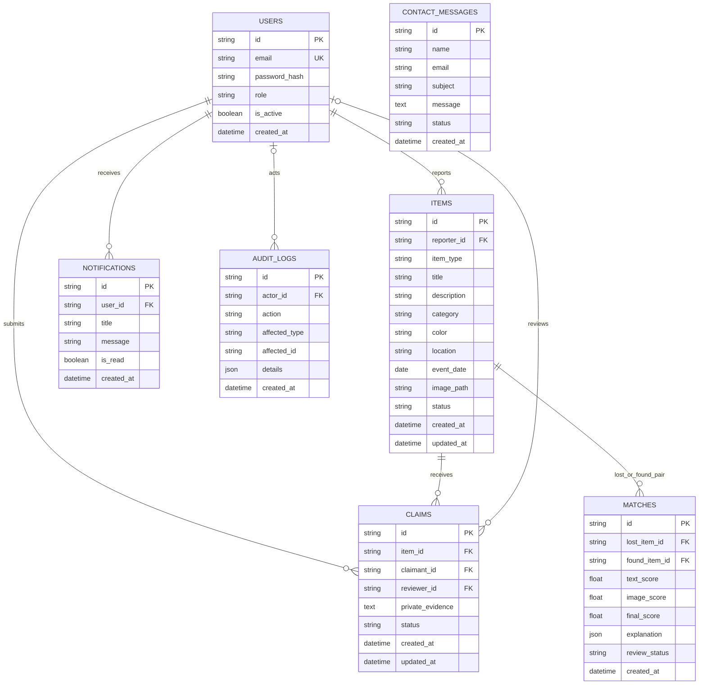
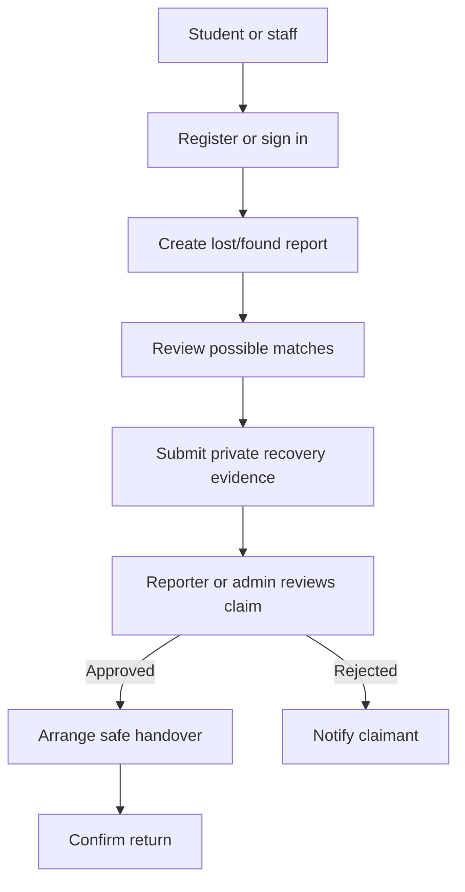
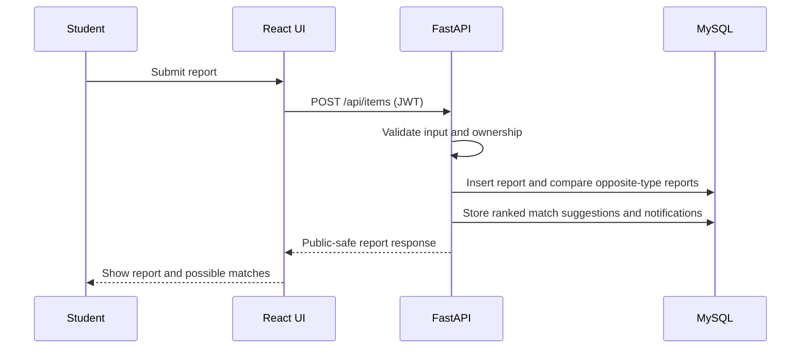

# LostLink System Design

## Architecture

The browser never receives password hashes, private claim evidence, or reporter email addresses in public item responses. The API validates ownership/role on every protected operation. Similarity is a suggestion only; a human must verify ownership.

## Relational Model

Users referenced by reports/claims use `RESTRICT` deletion so historical ownership is not silently destroyed. Item deletion cascades its claims/matches; notification item references and audit actors use `SET NULL`. Email is unique; role/status values and match score ranges are constrained; browse, review, notification, and match ranking columns are indexed. Contact requests are stored in a separate moderation queue and visible only to administrators.

## Use Case

## Data Flow

## Matching Evaluation

The initial matcher is deterministic and interpretable: cosine similarity on normalized, IDF-weighted tokens plus category, color, location-token overlap, and event-date proximity. It returns a normalized 0–100 ranking and contributing signals. Report owners may confirm or reject a suggestion; that feedback does not establish ownership or approve a claim. `backend/tests/test_matching.py` covers baseline behavior; precision/recall/F1 still require a labeled campus dataset and are intentionally not fabricated here.

## Project Report Outline

1. Abstract and problem statement
2. Existing campus recovery process and requirements
3. Architecture, threat model, and ER design
4. API and UI implementation
5. Matching approach and labeled-data evaluation
6. Security, accessibility, and test strategy
7. Deployment, limitations, and future work

## Future Enhancements

- Add a college-approved email verification and password-reset provider.
- Add object storage, image re-encoding, malware scanning, and signed private media URLs.
- Move authentication rate limits to a shared Redis-backed store for multi-instance deployments.
- Add image embeddings only after privacy review and a representative evaluation set exist.
- Add claim-message auditing, campus-office custody handoff, and reviewed match feedback.
- Deploy behind HTTPS with managed secrets, backups, monitoring, and retention policies.
